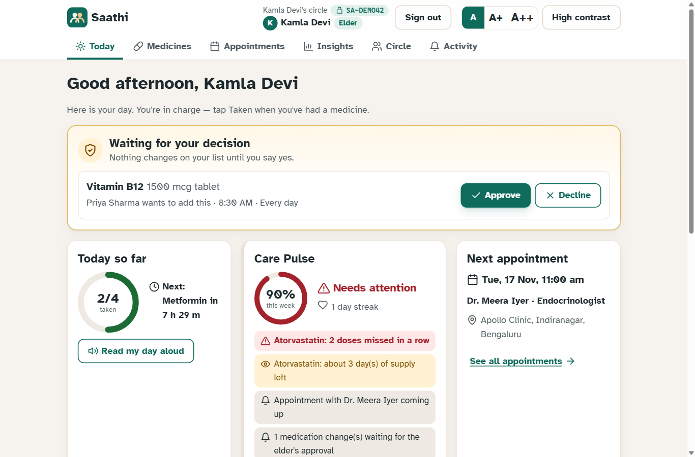
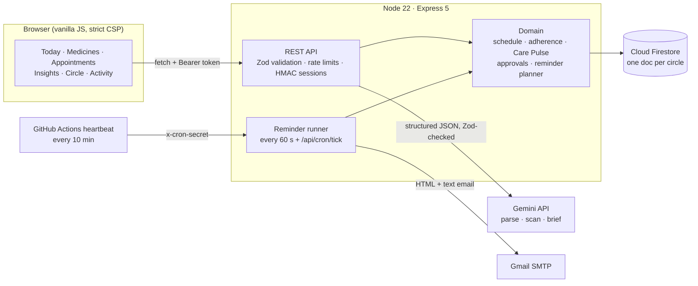
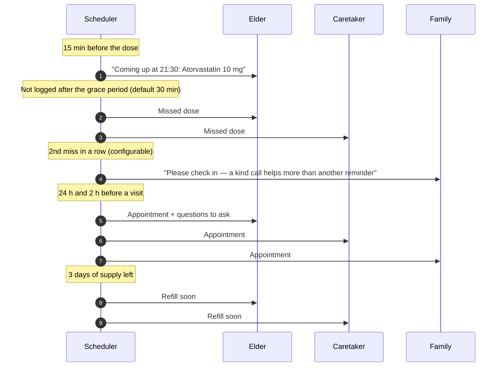
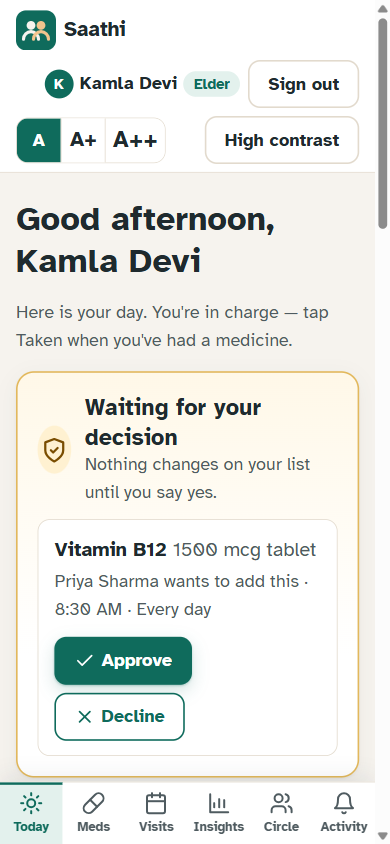

<div align="center">

# Saathi · साथी

**A shared care circle where an elder's medicines, doctor visits and daily routine stay on track, family stays informed, and nothing changes without the elder saying yes.**

[](https://github.com/AlgoMasterArpit/saathi-care/actions/workflows/ci.yml)


[](LICENSE)

**[Live app](#live-demo)** · **[Try the demo in 30 seconds](#try-it-in-30-seconds)** · **[How it meets each criterion](#how-saathi-meets-each-evaluation-criterion)** · **[Architecture](#architecture)**

Built for **PromptWars × Catalyst** (Hack2skill) on 15 Nov 2026.



<sub>The elder's home screen. Her daughter proposed a new medicine, and nothing changes until Kamla taps Approve. Care Pulse has already noticed two missed Atorvastatin doses and a refill running low.</sub>

</div>

---

## Contents

- [The problem](#the-problem)
- [What Saathi does](#what-saathi-does)
- [Try it in 30 seconds](#try-it-in-30-seconds)
- [Beyond a reminder app](#beyond-a-reminder-app)
- [How Saathi meets each evaluation criterion](#how-saathi-meets-each-evaluation-criterion)
- [Architecture](#architecture)
- [The reminder and escalation ladder](#the-reminder-and-escalation-ladder)
- [Google services](#google-services)
- [Security](#security)
- [Accessibility](#accessibility)
- [Testing](#testing)
- [Run it locally](#run-it-locally)
- [Deploy](#deploy)
- [API reference](#api-reference)
- [Project layout](#project-layout)
- [Limits](#limits)
- [How this was built](#how-this-was-built)

## The problem

An elder on four or five daily medicines has a routine that lives in too many places: pill boxes, prescription slips, a daughter's WhatsApp, a nurse's notebook. Doses get missed without anyone noticing. Refills run out on a Sunday. Before a doctor's visit, nobody remembers what to ask. And when family "helps", the elder often ends up being *managed* instead of being in charge.

The challenge asks for a shared, passcode-secured ecosystem for elders, caretakers and family. It should manage medicines, adherence and appointments, send proactive email reminders, and keep **the elder at the centre of their own healthcare decisions**.

## What Saathi does

| Challenge requirement | How Saathi delivers it | Where in code |
| --- | --- | --- |
| Shared ecosystem for elder, caretakers and family | One **care circle** per elder, with three roles and a permission matrix | [`src/domain/circle.js`](src/domain/circle.js) |
| Secure, passcode-based access | Circle code plus a **personal passcode for every member** (scrypt-hashed, revocable one by one), with HMAC-signed sessions | [`src/lib/security.js`](src/lib/security.js), [`src/routes/api.js`](src/routes/api.js) |
| View, add, edit and manage medication schedules | Times, weekdays, units per dose, stock and instructions, with full CRUD | [`src/schemas.js`](src/schemas.js), [`public/js/care.js`](public/js/care.js) |
| Track adherence | One-tap **Taken / Skip** logging that records who logged it. Shows a 7-day adherence %, a per-medicine rate and a streak | [`src/domain/care.js`](src/domain/care.js) |
| Monitor upcoming doctor appointments | Appointments with questions to ask, plus Google Calendar and Google Maps links | [`public/js/care.js`](public/js/care.js) |
| Email reminders for missed doses, upcoming doses and appointments | A scheduler runs every minute: upcoming-dose, missed-dose, escalation, appointment (24 h and 2 h) and refill emails, each sent exactly once | [`src/domain/reminders.js`](src/domain/reminders.js), [`src/scheduler.js`](src/scheduler.js) |
| Go beyond a basic reminder app | Elder approval workflow, Care Pulse, refill forecasting, Gemini prescription scan, Hindi care briefs, read-aloud | [Beyond a reminder app](#beyond-a-reminder-app) |
| Elder stays at the centre | **Changes by others become proposals the elder approves or declines.** Only the elder can remove members or change settings | `decideMedication` in [`src/domain/circle.js`](src/domain/circle.js) |

## Live demo

The deployed URL is linked from the repository description. The demo circle is seeded automatically on every boot.

## Try it in 30 seconds

Open the app and use the **Try the live demo** panel. Each button signs you in to circle `SA-DEMO42` as a different person:

| Person | Role | Passcode | What to try |
| --- | --- | --- | --- |
| Kamla Devi, 74 | Elder | `246810` | Tap **Taken** on a dose. Approve Priya's proposed Vitamin B12. Read your day aloud |
| Ravi Kumar | Caretaker (nurse) | `135790` | Log a dose on Kamla's behalf. Scan a prescription photo with Gemini |
| Priya Sharma | Family (daughter) | `112233` | Propose a medicine change and watch it wait for Kamla. Read the weekly Gemini brief in Hindi |

The demo circle has a week of realistic history: two missed Atorvastatin doses in a row (Care Pulse shows **Needs attention**), a refill running low, an endocrinologist visit in two days, and a pending proposal. For safety, the public demo circle **never sends real emails**; its reminders are written to the in-app notification log. To get real emails, create your own circle with your own address and press **Send me a test email**.

## Beyond a reminder app

1. **Elder-first consent.** When a caretaker or family member adds, edits or stops a medicine, it becomes a *proposal*. The elder sees it at the top of their day and approves or declines it. The elder can switch this off. Every action lands in an audit trail.
2. **Care Pulse.** A deterministic signal (`steady` / `watch` / `act`) built from 7-day adherence, consecutive misses, refill runway, upcoming visits and pending decisions. Every signal carries a plain-language reason. No LLM sits in this path, so it is explainable and testable.
3. **A kind escalation ladder.** The elder gets a nudge before a dose. A missed dose alerts the elder and caretaker after a grace period the elder sets. Only repeated misses reach the wider family, with a "call, don't nag" message.
4. **Refill forecasting.** Stock goes down when a dose is marked taken (and back up if that is undone). Saathi works out the days of supply left from the real schedule, weekly doses included, and emails before the strip runs out.
5. **Gemini as a careful helper, never a prescriber.**
   - *Describe a medicine in your own words* ("metformin 500 twice a day after food, I have 40") and get a structured schedule to review.
   - *Scan a prescription or medicine strip* with Gemini vision. Hard-to-read lines are flagged in notes, never guessed.
   - *A weekly care brief* in **English or Hindi** (wins, concerns, questions for the doctor), generated only from the circle's own numbers.

   Every Gemini response is forced into a JSON schema **and** re-validated with Zod before use. The system prompt forbids diagnosis and dose advice, and AI output only pre-fills a form for a person to confirm.
6. **Built for ageing eyes and hands.** It uses Atkinson Hyperlegible, a typeface designed for low-vision readers, with three text sizes, a high-contrast mode, read-aloud of the day (Web Speech API, `en-IN`), 44 px+ targets and a thumb-reach bottom bar on phones.
7. **Printable emergency card** with conditions, allergies, current medicines and the emergency contact, ready for a wallet or the fridge door.

## How Saathi meets each evaluation criterion

| Criterion | Evidence |
| --- | --- |
| **Code quality** | Layered design: pure domain functions (`src/domain`), thin HTTP layer (`src/routes`), swappable stores (`src/store`) and services injected into `createApp`. ESLint flat config, no dead code, small modules, self-describing names, and no framework or build step on the frontend |
| **Security** | Per-member scrypt passcodes with a random salt and constant-time compare. HMAC-SHA256 session tokens with expiry, and revocation that takes effect on the next request. A strict Helmet CSP (`script-src 'self'`, no inline code), HSTS, `frame-ancestors 'none'` and Permissions-Policy. Zod `.strict()` validation on every payload rejects unknown fields. Rate limits on sign-in, AI and email. Role checks in the domain layer, not only in the UI. No passcode hash ever leaves the server. Generic sign-in errors (no circle enumeration). Body limits (100 KB, 6 MB for scans only). The DOM is built with `textContent` only. The container runs as non-root, and the demo circle cannot send email |
| **Efficiency** | One Firestore document per circle, so a dashboard is **one read** and a change is **one transactional write**. Dose history is capped at 90 days and the audit and outbox logs are capped. `Intl.DateTimeFormat` instances are cached per timezone. gzip compression, ETag revalidation for static assets, and a framework-free frontend (~29 KB gzipped, zero client dependencies, no build step). The reminder runner reuses the in-flight tick, so concurrent triggers never double-send. Gemini falls back to a second model on failure |
| **Testing** | **66 tests, 97% line and 91% branch coverage** with Node's built-in runner (`npm run test:coverage`). They cover timezone and DST maths, token tampering, adherence, streaks, refills, the escalation ladder, approval flows, role permissions, scheduler de-duplication, demo email safety, mailer escaping, config parsing, Gemini fallback and output validation, and a full HTTP integration suite. CI runs lint, tests and `npm audit` on Node 22 and 24 |
| **Accessibility** | Semantic landmarks, a skip link, labelled inputs with linked hints and errors, `aria-live` announcements, focus moved to the heading on every view change, ARIA tabs with arrow-key support, native `<dialog>`, status shown by icon **and** text (never colour alone), WCAG AA contrast, a high-contrast theme, three text sizes, `prefers-reduced-motion`, read-aloud, and a print stylesheet for the emergency card |
| **Google services** | Gemini API through the official `@google/genai` SDK (structured output, vision and multilingual), Cloud Firestore (transactions), Gmail (SMTP with an app password), Google Calendar and Google Maps deep links, Google Fonts, and logs in the Cloud Logging JSON format with a Cloud Run-ready container. [Details below](#google-services) |
| **Problem statement alignment** | Every sentence of the brief maps to a feature and a file in [What Saathi does](#what-saathi-does). The "elder at the centre" line drives the core design choice: the approval workflow |

## Architecture



Every rule that matters (who may do what, when a dose is missed, who gets emailed) lives in pure functions under [`src/domain`](src/domain). They take a circle and a clock and return data, so the tests need no database, no network and no mocking of time.

## The reminder and escalation ladder



Each reminder has a stable key (for example `miss:med_x@2026-11-15T21:30`) recorded in the circle, so a reminder is sent **exactly once** even across restarts and overlapping triggers. Every email, delivered or not, is listed in the in-app **Notification log**, so the family can see what Saathi said and when.

## Google services

| Google service | How Saathi uses it | Code |
| --- | --- | --- |
| **Gemini API** (`@google/genai`) | Free-text medicine to schedule, prescription and strip photo to medicines (vision), weekly care brief in English or Hindi. JSON-schema output with Zod re-validation, a safety system prompt, and automatic fallback to a second model | [`src/services/gemini.js`](src/services/gemini.js) |
| **Cloud Firestore** | Persistent store. One document per circle, every change runs in a transaction, and `create()` guards against circle-code collisions | [`src/store/firestore.js`](src/store/firestore.js) |
| **Gmail** | Reminder delivery over Gmail SMTP with an app password, as large-type HTML plus a plain-text alternative | [`src/services/mailer.js`](src/services/mailer.js) |
| **Google Calendar** | One-tap "Add to Google Calendar" for every appointment | [`public/js/care.js`](public/js/care.js) |
| **Google Maps** | "Open in Google Maps" directions for every clinic | [`public/js/care.js`](public/js/care.js) |
| **Google Fonts** | Atkinson Hyperlegible (low-vision legibility) and Noto Sans Devanagari (Hindi) | [`public/index.html`](public/index.html) |
| **Cloud Logging / Cloud Run** | Structured JSON logs with `severity` and `httpRequest` fields. The non-root `Dockerfile` listens on `$PORT` and is ready for `gcloud run deploy` | [`src/lib/logger.js`](src/lib/logger.js), [`Dockerfile`](Dockerfile) |

## Security

- **Access model.** A circle code plus a personal passcode. The elder sets their own. Caretakers and family get a generated `NNNN-NNNN` passcode, shown once, that the elder can revoke at any time. Removing a member ends their session on the very next request, because tokens are re-checked against the member list.
- **Secrets.** All keys come from the environment. `.env` and service-account files are git-ignored, and the server refuses to start in production without a 32+ character `SESSION_SECRET`.
- **Least privilege by role.**

  | Action | Elder | Caretaker | Family |
  | --- | :-: | :-: | :-: |
  | View the circle, log doses, add appointments | ✅ | ✅ | ✅ |
  | Add, edit or stop medicines | ✅ directly | ✅ as a proposal* | ✅ as a proposal* |
  | Approve or decline proposals | ✅ | — | — |
  | Invite members | ✅ | ✅ | — |
  | Remove members, change settings | ✅ | — | — |

  \* Direct when the elder turns approvals off.
- **AI safety.** Gemini never decides anything. The Care Pulse and the reminders are deterministic code, and Gemini output only pre-fills forms for a person to review.

## Accessibility

<p align="center"></p>

**Audited with axe-core 4.14 (WCAG 2.0, 2.1 and 2.2 A/AA rules plus best practices): 0 violations** on the welcome page, all six app views and the medicine dialog. One duplicate-landmark finding on the Activity view was fixed and re-audited.

Designed and checked for **WCAG 2.2 AA**: keyboard-only use from end to end, visible focus rings, the 44 px minimum target size, text resizable to 150% without horizontal scroll at 360 px, colour plus icon plus text for every status, `lang` attributes for Hindi output, and reduced-motion support. Elders can listen to their day instead of reading it.

## Testing

```bash
npm test                # 66 tests, ~5 s, no network or database needed
npm run test:coverage   # line / branch / function coverage for src/**
npm run lint
```

| Suite | Focus |
| --- | --- |
| `time.test.js` | IST and New York DST conversions, date maths |
| `security.test.js` | Salted scrypt, forged, expired and foreign tokens, constant-time compare |
| `care.test.js` | Dose states, weekday schedules, adherence, streaks, refill runway, Care Pulse |
| `reminders.test.js` | Upcoming, missed, escalation, appointments, refill, de-duplication, opt-out |
| `circle.test.js` | Approval workflow, role permissions, stock accounting, dose-window validation |
| `scheduler.test.js` | Exactly-once delivery, demo-circle email safety, HTML escaping, SMTP failure |
| `config.test.js` | Production secret guard, credential parsing, Gemini fallback and output rejection |
| `api.test.js` | Full HTTP flow: create, invite, sign in, propose, approve, revoke, AI, cron auth, headers |

## Run it locally

```bash
git clone https://github.com/AlgoMasterArpit/saathi-care.git && cd saathi-care
npm install
cp .env.example .env    # add GEMINI_API_KEY (and optionally Gmail / Firestore)
npm run dev             # http://localhost:8080
```

With no Firestore credentials, Saathi uses an in-memory store. With no Gmail credentials, reminders are still planned and listed in the Notification log.

| Variable | Purpose |
| --- | --- |
| `SESSION_SECRET` | 32+ random characters, required in production |
| `GEMINI_API_KEY`, `GEMINI_MODEL` | Gemini access (default `gemini-3.5-flash`, fallback `gemini-3.1-flash-lite`) |
| `GMAIL_USER`, `GMAIL_APP_PASSWORD` | Reminder delivery |
| `FIRESTORE_CREDENTIALS` | Service-account JSON (raw or base64). Enables Firestore |
| `CRON_SECRET` | Enables `POST /api/cron/tick` for external schedulers |
| `PUBLIC_URL` | Link placed in reminder emails |

## Deploy

**Render (live):** New, then Blueprint, then this repo. [`render.yaml`](render.yaml) generates `SESSION_SECRET` and `CRON_SECRET` and asks for the rest. To keep reminders flowing while the free instance sleeps, set the repo variable `SAATHI_URL` and the secret `CRON_SECRET`; the [heartbeat workflow](.github/workflows/reminders.yml) then calls the tick every 10 minutes.

**Google Cloud Run:**

```bash
gcloud run deploy saathi --source . --region asia-south1 --allow-unauthenticated \
  --set-env-vars NODE_ENV=production,GEMINI_MODEL=gemini-3.5-flash \
  --set-secrets SESSION_SECRET=saathi-session:latest,GEMINI_API_KEY=gemini-key:latest
```

On Cloud Run, Firestore picks up the service identity automatically: set `GOOGLE_CLOUD_PROJECT` and drop `FIRESTORE_CREDENTIALS`.

## API reference

All endpoints are JSON. Authenticated routes need `Authorization: Bearer <token>`. Errors look like `{ "error": "...", "details": [{ "field", "message" }] }`.

| Method | Path | Who | Purpose |
| --- | --- | --- | --- |
| `POST` | `/api/circles` | anyone | Start a circle (elder name, email, timezone, passcode) |
| `POST` | `/api/sessions` | anyone | Sign in with circle code + passcode |
| `GET` | `/api/circle` | member | Full role-aware view: today, pulse, adherence, medicines, visits, activity, outbox |
| `PATCH` | `/api/circle/profile` · `/settings` | elder, caretaker · elder | Health profile · approval and escalation settings |
| `POST` / `DELETE` | `/api/circle/members[/:id]` | elder, caretaker · elder | Invite (returns a one-time passcode) · revoke |
| `PATCH` | `/api/circle/members/me` | member | Email opt-in |
| `POST` / `PATCH` / `DELETE` | `/api/circle/medications[/:id]` | member | Direct for the elder, a proposal for others |
| `POST` | `/api/circle/medications/:id/decision` | elder | Approve or decline |
| `POST` | `/api/circle/doses` | member | Mark taken or skipped (today and the previous two days) |
| `POST` / `PATCH` / `DELETE` | `/api/circle/appointments[/:id]` | member | Manage visits |
| `POST` | `/api/circle/test-email` | member | Send yourself a sample reminder |
| `POST` | `/api/ai/medication` · `/scan` · `/brief` | member | Gemini parse · prescription scan · weekly brief |
| `POST` | `/api/cron/tick` | `x-cron-secret` | Run the reminder planner now |
| `GET` | `/api/health` | anyone | Liveness, store kind, feature flags |

## Project layout

```text
src/
  server.js            wiring: config → store → services → app → scheduler
  app.js               security headers, body limits, static files, error handling
  routes/api.js        HTTP endpoints, auth, rate limits
  domain/care.js       schedule, adherence, streak, refill, Care Pulse
  domain/circle.js     roles, approvals, dose logging, members, view model
  domain/reminders.js  reminder planner and escalation ladder
  scheduler.js         exactly-once reminder delivery
  services/            gemini.js, mailer.js
  store/               firestore.js, memory.js
  lib/                 time, security, errors, logger
  schemas.js           Zod schemas for every payload
  demo.js              seeded demo circle
public/                accessible vanilla-JS client (no build step)
test/                  node:test suites
```

## Limits

- **Not a medical device.** Saathi does not give medical advice, check drug interactions or change doses. Gemini output is a draft for a person to confirm.
- **Email only.** SMS, WhatsApp and push notifications are natural next channels, but they are not built.
- **Single-instance scheduler.** The in-process runner and the cron endpoint de-duplicate within one instance, and Firestore transactions keep writes safe. Many instances would need a distributed lock or Cloud Scheduler as the only trigger.
- **Free-tier hosting** sleeps when idle. The GitHub Actions heartbeat wakes it every 10 minutes, so a reminder can arrive up to about 10 minutes late after a quiet period.
- **Demo data is synthetic.** Kamla Devi, Ravi and Priya are fictional, and the demo circle never sends real email.
- **Scale ceiling.** One document per circle holds 90 days of dose history comfortably within Firestore's 1 MB limit. A sub-collection would be the upgrade path for years of history.

## How this was built

Built in one day for PromptWars × Catalyst, with AI-assisted development throughout. The design decisions were ours: the elder-approval model, deterministic Care Pulse, no LLM in any safety path, and exactly-once reminders. Every line was reviewed and is covered by the test suite. Commits are small and incremental, so the history shows how the build went.

## License

[MIT](LICENSE) © 2026 Arpit Tyagi
